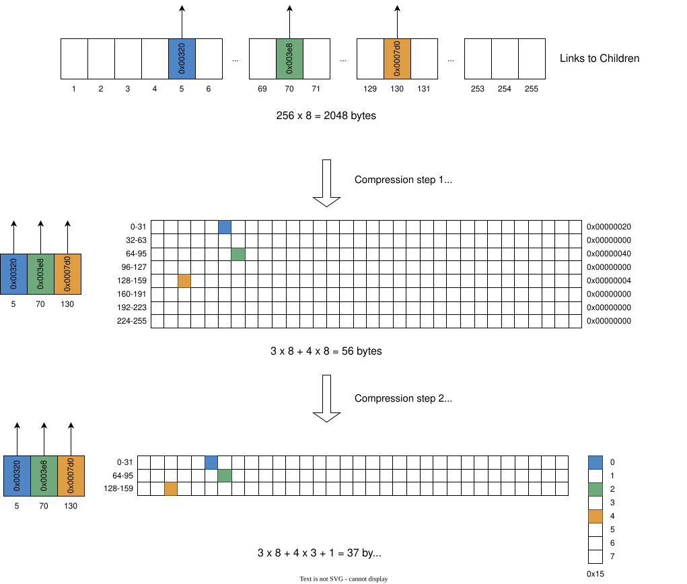
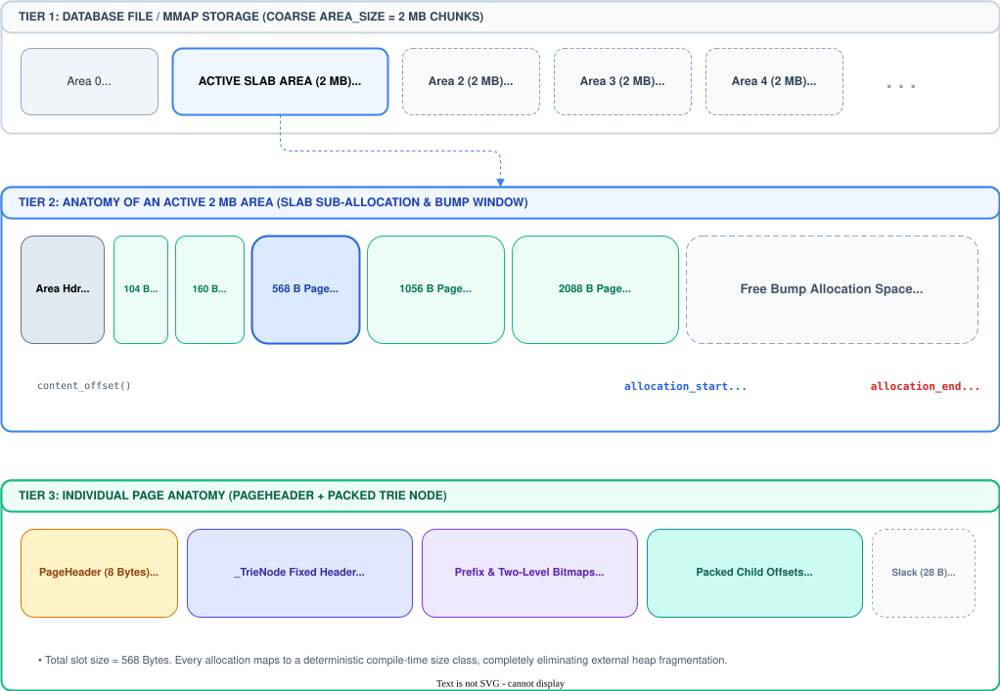
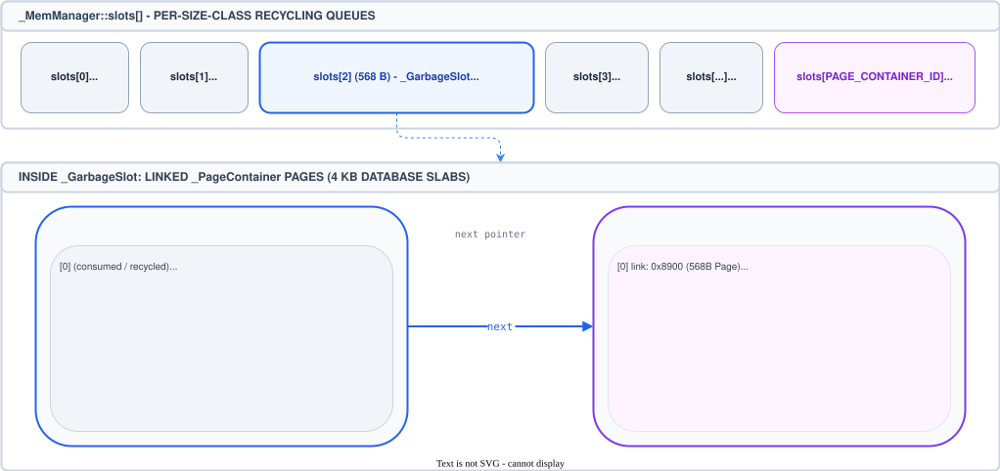
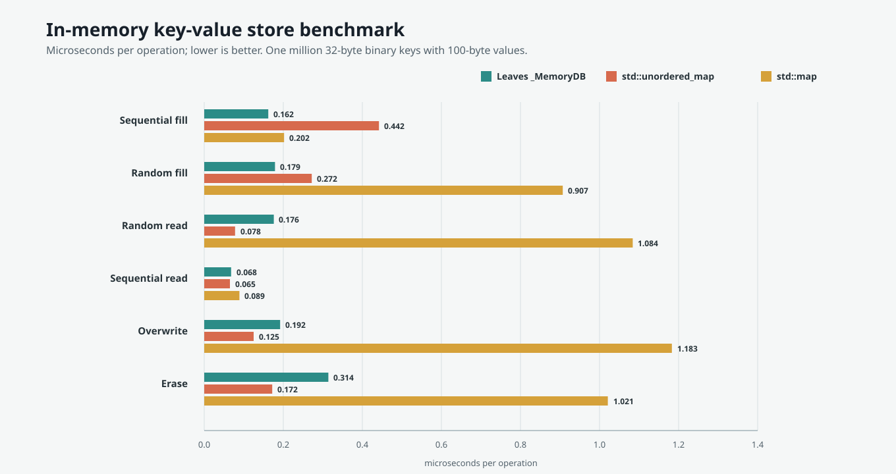
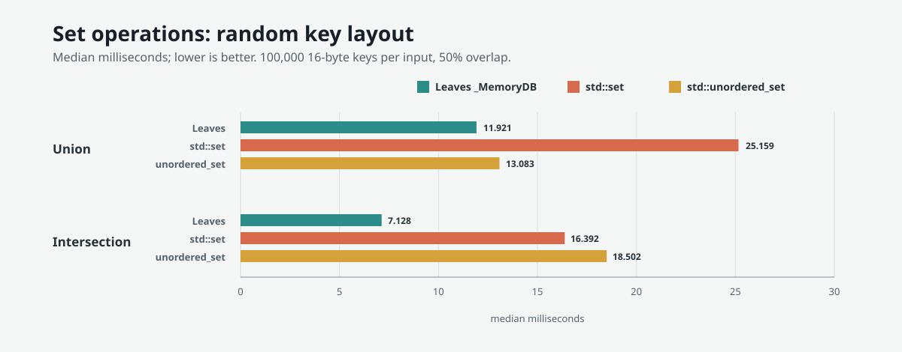
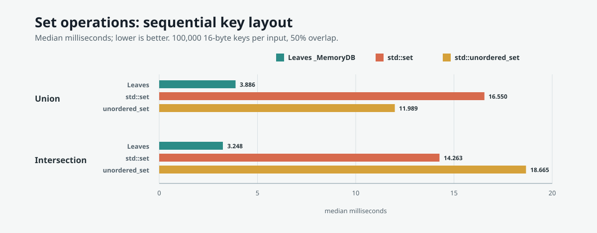

# A Space-Efficient Trie Design for Key-Value Stores

Most embedded key-value stores are built around a small family of storage structures: [B-trees](https://en.wikipedia.org/wiki/B-tree), [B+ trees](https://en.wikipedia.org/wiki/B%2B_tree), [LSM trees](https://en.wikipedia.org/wiki/Log-structured_merge-tree), and [hash tables](https://en.wikipedia.org/wiki/Hash_table). [Tries](https://en.wikipedia.org/wiki/Trie) are usually reserved for routing tables, dictionaries, autocomplete, and specialized string indexes.

This article examines whether a suitable trie variant can outperform conventional key-value-store layouts.

## Why tries are not used as databases

A [trie](https://en.wikipedia.org/wiki/Trie) is a search tree whose path is determined by the symbols of a key. For byte strings, each step consumes one byte. This gives tries several appealing properties for key-value storage.

Lookup depends on key length only, $O(k)$, rather than directly on the number of stored records. A search does not compare the requested key with separator keys at every tree level or rely on collision handling. Common prefixes are shared structurally, and ordered traversal follows naturally when child edges are kept in byte order.

Those properties alone do not make a practical database.

The conventional database answer is the [B-tree](https://en.wikipedia.org/wiki/B-tree), or, more commonly, the [B+ tree](https://en.wikipedia.org/wiki/B%2B_tree). For a B-tree containing $n$ records with fanout $B$, a lookup visits $O(\log_B n)$ pages. Searching the separator keys in those pages takes $O(\log n)$ key comparisons overall when each page uses an efficient search. The high fanout keeps page visits low, while packed neighboring keys make sorted iteration efficient. B-trees were designed around slow storage and fixed-size pages, so each page is organized to bring many useful keys into memory at once rather than paying for one record at a time. Their strength is therefore not only predictable access time but also economical use of each page: most of the space fetched from storage contributes to the search.

A naive trie loses this comparison. A byte trie can have up to 256 branches per internal node. If every node stores a full 256-entry pointer array, most entries will usually be empty. The database then pays for absence: memory and disk space are reserved for byte values that have no branch. A 256-entry array of 8-byte links uses 2 KiB per node, even when only a few branches are present.

The central problem is therefore space. The direct addressing that makes a trie attractive also creates a sparse node representation. This can be acceptable for in-memory dictionaries, and prefix semantics can justify the cost in specialized domains such as IP routing. For a general persistent key-value store, unused child slots and extra node reads are a substantial tax.

[Compressed tries](https://en.wikipedia.org/wiki/Radix_tree), [Patricia trees](https://xlinux.nist.gov/dads/HTML/patriciatree.html), and [adaptive radix trees](https://db.in.tum.de/~leis/papers/ART.pdf) address parts of this problem by compressing empty paths, reducing child storage, or selecting node formats according to density. These techniques do not solve the general space problem on their own: [linked-list](https://en.wikipedia.org/wiki/Linked_list) or [map-of-children](https://en.wikipedia.org/wiki/Associative_array) representations avoid reserving unused child slots, but introduce pointer chasing, variable node layouts, and poorer locality, while long keys can still create chains of single-child nodes that turn one logical key into many stored nodes.

## Two-Level Bitmap Compression To Solve the Space Problem

A new variant of trie node is a hybrid structure that combines a [radix trie](https://en.wikipedia.org/wiki/Radix_tree) with two-level [bitmap](https://en.wikipedia.org/wiki/Bit_array) compression. This can represent sparse children compactly while preserving direct byte selection:



Consider a node with branches labeled by byte values 5, 70, and 130. A naive representation allocates one branch-link slot for every possible byte value, retaining 256 offsets although only three branches are used. With 8-byte offsets, that array occupies `256 * 8 = 2,048` bytes. The first compression extracts those three offsets into a packed branch-offset array in byte-label order: offset 0 belongs to byte 5, offset 1 to byte 70, and offset 2 to byte 130. A 256-bit presence bitmap, held as eight 32-bit words for ranges 0-31 through 224-255, records which byte values have a branch. The compressed representation uses three offsets and 32 bytes of bitmap data, or `3 * 8 + 32 = 56` bytes.

The second compression removes bitmap words that contain no set bits. Byte values 5, 70, and 130 lie in groups 0, 2, and 4, so only those three 32-bit words remain. They are packed into the lower-bitmap array, while an 8-bit upper bitmap records the groups that contain branches: `0b00010101` has bits 0, 2, and 4 set. The resulting node stores three branch offsets, three lower bitmap words, and the one-byte upper bitmap: `3 * 8 + 3 * 4 + 1 = 37` bytes.

To find the branch for byte `c`, first compute its group as `c >> 5` and test the corresponding bit in the upper bitmap. The population count of the preceding set upper bits identifies that branch group's packed lower bitmap. Then use `c & 0x1f` to test the bit within the 32-bit word. If that bit is set, population counts over the preceding lower bits determine the branch's position in the packed offset array. This preserves a predictable, compact lookup path without reserving storage for absent branches.

Modern CPUs provide efficient population-count operations for this layout.

The trie is also a radix trie: sequences of nodes with a single branch are collapsed into a prefix stored at one node.

Conceptually, the variable-sized portion of a `_TrieNode` looks like the following c++ pseudo-structure:

```cpp
struct _TrieNode {
    uint16_t _branch_count;       // number of packed branch offsets
    uint8_t _branch_bits_index;   // populated 32-byte groups
    uint8_t _prefix_len;          // radix-prefix length
    uint8_t _branch_bits_pos;     // start of branch_bits[], in uint32_t units
    uint8_t _branch_offsets_pos;  // start of branch_offsets[], in offset_t units
    uint8_t _prefix[];            // compressed key bytes
    uint32_t _branch_bits[];      // one word per populated group
    offset_t _branch_offsets[];   // packed child links in byte order
};
```

The sketch shows the layout rather than literal C++. A concrete implementation uses one variable-sized allocation; `_branch_bits_pos` and `_branch_offsets_pos` locate the packed bitmap and child-link regions after the compressed prefix. Padding preserves the alignment required by the bitmap words and link type.

A separate leaf node stores key and value data:

```cpp
struct LeafNode {
    uint8_t key_length;
    uint8_t key[];
    uint64_t value;
};
```

## Memory Layout Is Crucial

Compact nodes must also be allocated and reclaimed efficiently. Rather than using one arbitrary allocation size, Leaves places each allocation in a fixed page class calculated from the node layout. The classes cover common fanouts: 2, 3, 4, 10, 16, 64, and 256 branches, with additional classes for pages with larger leaves. A class gives an allocation a stable size and therefore lets the allocator reuse space without splitting or coalescing variable-sized blocks.



The spatial blueprint shows how those classes fit inside the database's area-based storage. The memory manager obtains fixed-size areas, keeps one area as the active bump-allocation region, and returns other available areas to the area pool. Within an area, pages are carved from the active region according to their class, so a node uses only the space required by its layout while nearby allocations remain easy to address and persist.

Allocation follows the paths shown in the diagram. `_MemManager` first asks the selected class for a reusable page. If none is eligible, it consumes a retained tail from an earlier area, then advances the active area's allocation pointer, and finally obtains another area when the active one cannot satisfy the request. Retaining the larger exhausted tail makes otherwise usable space available for later allocations instead of discarding it.




The recycling diagram shows the other half of the design. The memory manager stores one recycling slot for every page class in a compact array, so selecting a class also selects its FIFO queue directly. When copy-on-write makes a page obsolete, the page is appended to that class's queue together with the transaction that released it. The queue keeps pages in release order: the oldest entry is the next candidate, but it is not reusable until every reader snapshot that could still observe the old page has advanced beyond that transaction. An ineligible entry therefore remains queued rather than being skipped or repurposed early.

Together, the two diagrams describe a simple allocation decision: reuse a transaction-safe page of the right class when possible; otherwise carve space from retained or active area storage. This keeps allocation fast, preserves page-size compatibility, and delays reclamation until older snapshots can no longer refer to the page.


## How Does It Perform?

Leaves implements the preceding ideas: radix-compressed trie nodes, two-level bitmap-indexed children, page-oriented allocation and recycling, and copy-on-write updates for its persistent storage. The following measurements describe one local run, not a universal ranking. Storage hardware, processor architecture, compiler options, value sizes, and access patterns all affect the result.

### In-Memory Comparison

The following table compares Leaves' in-memory trie with [`std::unordered_map`](https://en.cppreference.com/w/cpp/container/unordered_map) and [`std::map`](https://en.cppreference.com/w/cpp/container/map). The test used one million randomly generated 32-byte binary keys, 100-byte values, and two rounds on Linux 6.8, GCC 13.3, and an Intel Core i7-12700KF. The figures below are microseconds per operation; lower is better.

| Workload | Leaves `_MemoryDB` | `std::unordered_map` | `std::map` |
| --- | ---: | ---: | ---: |
| Sequential fill | 0.162 | 0.442 | 0.202 |
| Random fill | 0.179 | 0.272 | 0.907 |
| Random read | 0.176 | 0.078 | 1.084 |
| Sequential read | 0.068 | 0.065 | 0.089 |
| Overwrite | 0.192 | 0.125 | 1.183 |
| Erase | 0.314 | 0.172 | 1.021 |



The same run reported 195.0 MiB for `_MemoryDB`, 212.1 MiB for `std::unordered_map`, and 219.3 MiB for `std::map` after filling the dataset. Those numbers are allocator-specific process or container measurements, so they are useful as a local comparison rather than as a portable memory-use guarantee. The trie performed particularly well on insertion and ordered traversal, while the hash table retained its expected advantage for random reads and overwrites.

### Persistent Comparison

For persistent storage, the benchmark compares Leaves with LMDB, with `MDB_WRITEMAP` and `MDB_MAPASYNC` enabled. It uses one million 16-byte decimal keys, 100-byte values, one million reads, and batches writes in groups of 1,000 operations. The table reports one local run on the same Linux, compiler, and processor configuration as above.

| Workload | Leaves (microseconds/op) | LMDB `--wmap` (microseconds/op) |
| --- | ---: | ---: |
| Sequential fill | 0.093 | 0.088 |
| Random fill | 0.336 | 0.815 |
| Overwrite | 0.358 | 0.886 |
| Random read | 0.262 | 0.494 |
| Sequential read | 0.042 | 0.016 |

On this workload, Leaves was faster for random writes and random reads, while LMDB was faster for sequential insertion and sequential traversal.

LMDB's stronger sequential-read performance is consistent with better data locality. Copying a Leaves database into a new one improves locality; in this benchmark, the copied database's sequential-read performance is comparable to LMDB's:

| Workload | After random fill (microseconds/op) | After Merger copy (microseconds/op) | Speedup |
| --- | ---: | ---: | ---: |
| Random read | 0.249 | 0.227 | 1.10x |
| Sequential read | 0.048 | 0.019 | 2.53x |

For a broader performance discussion, see [Can Persistent Tries Beat LMDB? Leaves Database Benchmarked](https://hackernoon.com/can-persistent-tries-beat-lmdb-leaves-database-benchmarked).

## Set Operations

Trie structure can make set operations more than a sequence of independent key lookups. Keys with common byte prefixes already occupy common paths, so union can merge matching paths and their child branches directly. Intersection can compare those paths and skip a whole subtree as soon as one input has no matching branch. This avoids repeatedly searching from each root for every key and can reduce key comparisons and intermediate work, especially when keys share prefixes or the input sets have substantial overlap. The result remains in lexicographic key order.

The following benchmark results compare Leaves' in-memory trie with [`std::set`](https://en.cppreference.com/w/cpp/container/set) and [`std::unordered_set`](https://en.cppreference.com/w/cpp/container/unordered_set). Each input has 100,000 unique 16-byte binary keys and empty values, with 50% overlap; the benchmark uses seed 301 and five rounds. Random and sequential layouts use the same key counts and overlap, but sequential keys share more trie paths. Timings are median milliseconds for the operation only, including result growth and excluding setup, verification, and destruction; lower is better. The benchmark verifies every result and its cardinality. This local run used Linux 7.0.0-42-generic and GCC 15.2.0.

| Layout | Operation | Result keys | Leaves `_MemoryDB` median (best) ms | `std::set` median (best) ms | `std::unordered_set` median (best) ms |
| --- | --- | ---: | ---: | ---: | ---: |
| Random | Union | 150,000 | 11.921 (11.331) | 25.159 (23.055) | 13.083 (11.062) |
| Random | Intersection | 50,000 | 7.128 (5.994) | 16.392 (16.151) | 18.502 (17.546) |
| Sequential | Union | 150,000 | 3.886 (3.097) | 16.550 (15.379) | 11.989 (11.049) |
| Sequential | Intersection | 50,000 | 3.248 (2.654) | 14.263 (13.962) | 18.665 (18.031) |

Median-time charts (milliseconds; lower is better):





The trie is competitive with the hash set for random-layout union, faster than both standard containers for random-layout intersection, and faster for both operations with the sequential layout. The sequential case illustrates the benefit of shared trie paths; the different timings also show why these results should not be generalized to other key layouts, overlap ratios, or machines. See [the benchmark documentation](../../benchmarks/README.md#set-operations) for how to build and run it.

## How to Reproduce the Results

On a POSIX system, clone the `benchmark-results-2026-11-01` tag to use the benchmark code pinned for these results, then configure an optimized build with the benchmark targets enabled. The tag points to commit `6c79fd31aae7f3fe7917fd68dad7ce24241b0b97`. Run these commands from the repository root; they require CMake and a supported C++ compiler:

```bash
git clone --branch benchmark-results-2026-11-01 --recurse-submodules https://github.com/kochelmonster/leaves.git
cd leaves
cmake -S . -B build/bench-repro -DCMAKE_BUILD_TYPE=Release \
    -DLEAVES_BUILD_TESTS=OFF -DLEAVES_BUILD_BENCHMARKS=ON -DLEAVES_GCOV=OFF
cmake --build build/bench-repro --target bench_memdb_vs_hashtable db_bench_leaves bench_set_operations --config Release -j4
```

The in-memory table and memory measurements come from `bench_memdb_vs_hashtable`:

```bash
./build/bench-repro/bench_memdb_vs_hashtable --num=1000000 --key_size=32 --val_size=100 --rounds=2 --benchmarks=fillseq,fillrandom,readrandom,readseq,overwrite,erase
```

For the persistent comparison, build the LMDB benchmark target and run both benchmarks. The LMDB target requires the LMDB development files to be installed:

```bash
cmake --build build/bench-repro --target db_bench_mdb --config Release -j4
./build/bench-repro/db_bench_leaves --benchmarks=fillseq,fillrandom,overwrite,readrandom,readseq --num=1000000 --reads=1000000 --value_size=100 --batch_size=1000 --db=build/bench-repro/leaves-persistent
./build/bench-repro/db_bench_mdb --wmap --benchmarks=fillseq,fillrandom,overwrite,readrandom,readseq --num=1000000 --reads=1000000 --value_size=100 --batch_size=1000 --db=build/bench-repro/lmdb-persistent
```

To compare reads before and after the merger copy, run the same random-fill workload with and without `--move_after_fill=1`. The copy happens after the fill and is not included in its timing; the subsequent reads use the resulting database:

```bash
./build/bench-repro/db_bench_leaves --benchmarks=fillrandom,readrandom,readseq --num=1000000 --reads=1000000 --value_size=100 --batch_size=1000 --db=build/bench-repro/leaves-before-copy
./build/bench-repro/db_bench_leaves --benchmarks=fillrandom,readrandom,readseq --num=1000000 --reads=1000000 --value_size=100 --batch_size=1000 --move_after_fill=1 --db=build/bench-repro/leaves-after-copy
```

The set-operation results use 100,000 keys per input, 50% overlap, seed 301, and five rounds. Run both key layouts:

```bash
./build/bench-repro/bench_set_operations --num=100000 --rounds=5 --overlap=50 --seed=301 --layout=random
./build/bench-repro/bench_set_operations --num=100000 --rounds=5 --overlap=50 --seed=301 --layout=sequential
```

These commands reproduce the workloads and report timings for the local machine; they do not guarantee identical numbers. The in-memory and set-operation benchmarks verify their results outside the timed region. For additional flags and timing details, see the [benchmark documentation](../../benchmarks/README.md).

## Conclusion

The main obstacle to using tries as general-purpose databases is not their lookup model but the cost of representing sparse branches and long single-child paths. An effective approach can be a radix-prefix compression and a two-level bitmap that packs only present child links. Page classes, area-based allocation, copy-on-write updates, and transaction-aware recycling extend that compact node representation into a persistent storage design.

In these measurements, the trie outperformed the B-tree-based LMDB on random fills, overwrites, and random reads, and it also beat `std::unordered_map` on the in-memory random-fill workload. This suggests that for write-intensive workloads, allocation and memory management can matter more than the lookup algorithm alone. Sequential reads benefited substantially from improved data locality: copying a randomly filled Leaves database brought read time close to LMDB in this run. Leaves also outperformed `std::set` and `std::unordered_set` in every set-operation workload tested.
